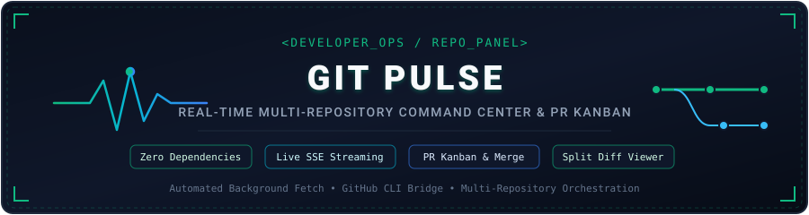
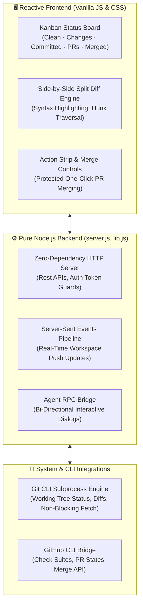

<p align="center">
  
</p>

<p align="center">
  <a href="https://github.com/Rithikasri-code/git-pulse"></a>
  
  
  
  
  <a href="LICENSE"></a>
</p>

---

## ⚡ Overview

**GitPulse** is a lightweight, zero-dependency developer workspace command center designed to answer one critical question across all your active codebases: **What is left for me to do?**

Operating as a single-window dashboard running on standard Node.js without any third-party npm packages, GitPulse monitors local Git working trees, branch divergence, unpushed commits, and live GitHub Pull Request statuses across dozens of repositories simultaneously.

---

## 🏗️ System Architecture



---

## 🚀 Key Technical Highlights

### 1. **Zero-Dependency Architecture**
Built completely on top of Node.js built-in modules (`http`, `child_process`, `fs`, `crypto`, `events`). No bloated `node_modules`, no vulnerability alerts, and instant sub-second boot times.

### 2. **Real-Time Kanban Pipeline**
Categorizes every configured repository into dynamic lifecycle columns:
* **Clean:** Repositories fully synced with remote base branches.
* **Changes:** Local unstaged or uncommitted working modifications with instant diff metrics (`+/−` line counters).
* **Committed:** Local commits awaiting push to remote.
* **Pull Requests:** Active PRs prioritized by readiness—merge-ready green checks appear first, followed by pending reviews or failing check suites.
* **Merged:** Branches successfully integrated, offering single-click `/flow-base` cleanup.

### 3. **Non-Blocking Background Fetching**
Runs quiet background fetches with exponential backoff, ensuring remote tracking branches remain fresh without taking working tree locks or prompting credentials.

### 4. **Side-by-Side Split Diff Viewer**
Inspects local working tree diffs in a split two-column comparative view with syntax recognition, line-number gutters, and binary file safety checks.

---

## 💻 Quickstart

### Prerequisites
* **Node.js 20+**
* **Git** installed and on system PATH
* **GitHub CLI (`gh`)** authenticated:
  ```bash
  gh auth login
  ```

### Launch
```bash
# Clone the repository
git clone https://github.com/Rithikasri-code/git-pulse.git
cd git-pulse

# Copy example configuration
cp config.example.json config.json

# Boot dashboard and open in browser
node server.js --open
```

---

## ⚙️ Configuration (`config.json`)

Configure your target repositories and grouped workspaces:

```json
{
  "repos": [
    {
      "id": "retro-rts",
      "path": "d:/Mac/project/booths/retro-rts",
      "group": "games"
    },
    {
      "id": "sprint-flow",
      "path": "d:/Mac/project/booths/sprint-flow",
      "group": "tools"
    }
  ],
  "port": 3456
}
```

---

## 🧪 Verification

Run internal test suites validating diff parsing, check rules, and RPC communication:

```bash
npm test
```

---

## 📄 License

Distributed under the **MIT License**. See [LICENSE](LICENSE) for details.
